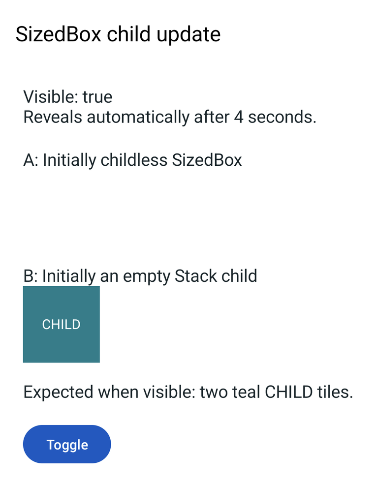

# DartNative: adding a child to an initially childless SizedBox

A standalone Android reproduction using only DartNative widgets. The entire
demo is in [lib/main.dart](lib/main.dart). It does not use an image plugin,
image cache, `CanvasSurface`, custom painter, application services or assets.

## Run

With an installed DartNative SDK and a connected Android device:

```sh
git clone https://github.com/reynard93/dartnative-sizedbox-child-repro.git
cd dartnative-sizedbox-child-repro
dn run --profile -d <android-device-id>
```

Android scaffolding is included. No `dn create`, manifest edits, copied SDK
files, app credentials or environment file is needed. `dn run` resolves the
dependencies and generates the platform registrant and local build configuration.
The standard DartNative installation/licensing requirements still apply.

On phones that show an installation confirmation, approve this reproduction's
ordinary installation prompt. The package is
`dev.dojojojo.repro.sized_box_child_repro`, independent of any other app.

## Steps and observed result

1. Launch and wait four seconds without tapping. The label changes from
   `Visible: false` to `Visible: true`.
2. Both rows should now show an 80-by-80 teal `CHILD` tile. On the tested runtime,
   **A remains blank and only B shows its tile**.
3. Tap **Toggle** twice, pausing between taps. B disappears and reappears;
   A still never shows its child.

Both rows return a `SizedBox` at the same position in a retained `LayoutBuilder`.
Neither box has a key or an application-forced remount. A starts with a null
child; B starts with an empty `Stack` child. The same state and same constant
tile drive both rows:

```dart
// A: blank after false -> true.
SizedBox(
  width: visible ? 80 : 0,
  height: visible ? 80 : 0,
  child: visible ? tile : null,
)

// B: working control, with a child-bearing container from the first build.
SizedBox(
  width: visible ? 80 : 0,
  height: visible ? 80 : 0,
  child: Stack(children: [if (visible) tile]),
)
```

The timer checks `mounted` and is cancelled on disposal. Toggle uses an ordinary
native button and `setState`. There are no manual element lifecycle calls,
exception suppressors or fabricated pass/fail checks.

## Recorded evidence

**[Watch the Xiaomi reproduction](evidence/xiaomi-profile.mp4)** — automatic
reveal followed by hide/show using Toggle. This is a real screen recording,
not a rendered mock-up. It is cropped to the application content and scaled;
the sequence is not sped up or reordered.



The [evidence notes](evidence/README.md) describe the capture and list matching
logs, the before screenshot and the exact SDK identity.

## Verified environment and scope

- Physical Xiaomi `2602BPC18G`, Android 16 / API 36, arm64-v8a,
  1280-by-2772 pixels, density 520.
- DartNative `3.45.0-0.1.pre`, framework `4c1cdb074e0` (2026-09-27).
- Engine revision `2baa73665c`, hash
  `868544bccad64b70d0c00cfc5010440dae673b94`.
- Dart `3.12.0-192.0.dev`.

Reproduced on 2026-09-28 in profile mode, including a cold launch and subsequent
manual toggles. `dn analyze --no-pub lib` reports no issues. See the saved
[build/run output](evidence/profile-build-run.txt) and
[analysis output](evidence/analyze.txt).

Only Android is scaffolded and tested here. No iOS result is claimed. The issue
is missing child rendering, not a crash; the reproduction logs state changes,
while the video and screenshots establish which child actually appears.

## Requested framework behavior

Updating a retained `SizedBox` from `child == null` to a non-null child should
mount that child normally. B is a bounded mitigation/control, not a framework
fix. Please keep A unchanged when verifying a corrected SDK, and also check
child removal/readdition and both platforms upstream.

No SDK binaries, build outputs, developer signing material, account data or
application-specific source/assets are distributed in this repository.
